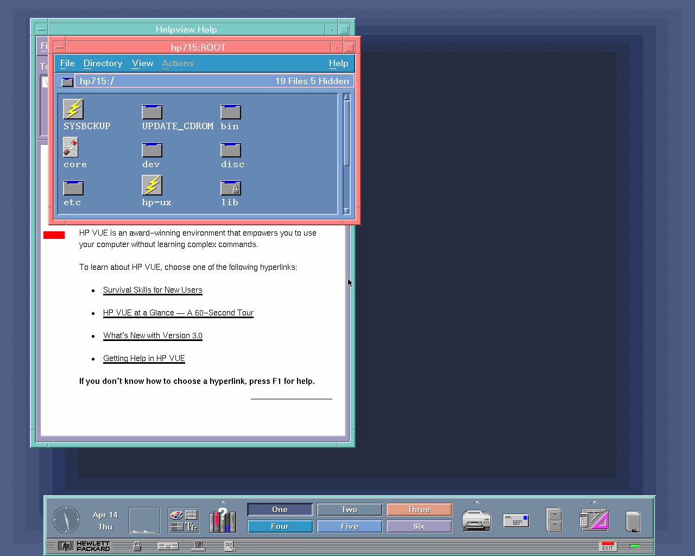
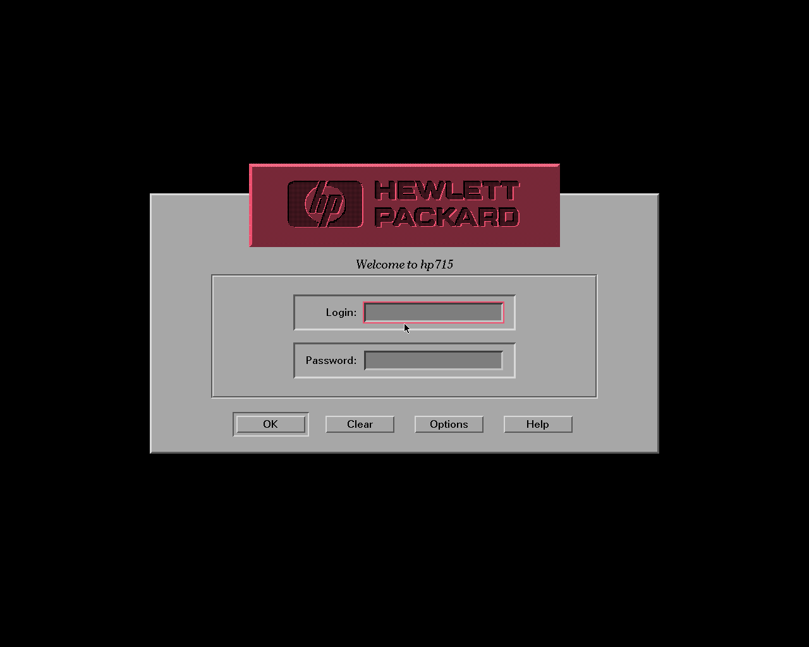
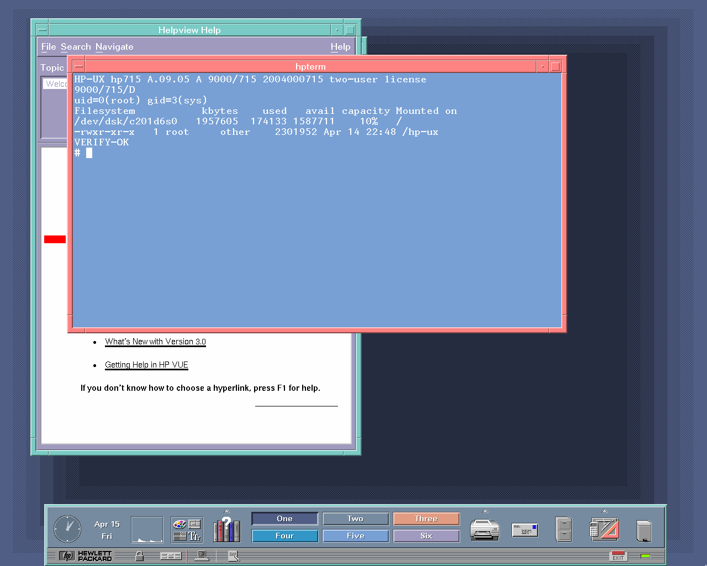
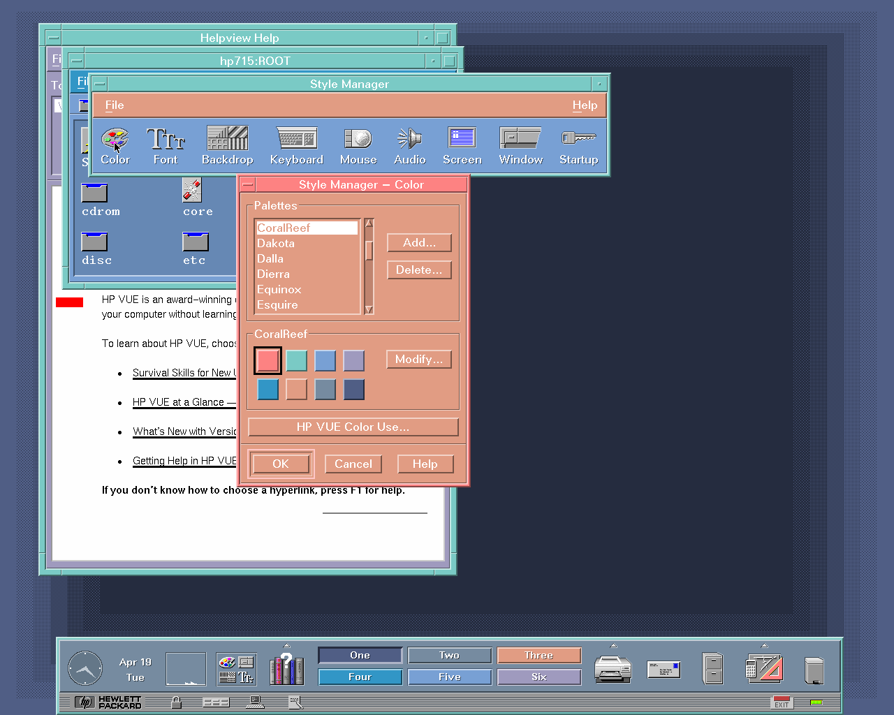
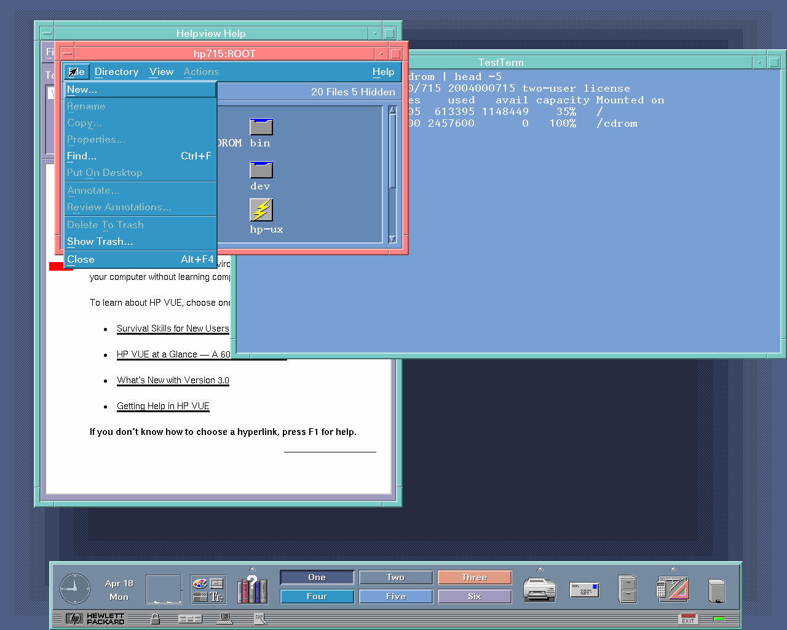

# HP-UX 9.05 on QEMU

HP-UX 9.05 (1994) running on QEMU's emulated HP 9000/715 workstation (`-M 715`), from
the original CDs to the HP VUE desktop.



## Why this fork exists

Stock QEMU couldn't run HP-UX 9.05 at all: the installer's kernel panicked right after it
loaded. Most of what it took to fix that is now in QEMU itself. As of QEMU master from
31 October 2026 (the `hppa-715-2` pull request) and SeaBIOS-hppa v27, these are upstream:

- **Memory protection and CPU type.** 15-bit PA-RISC 1.1 protection IDs instead of 18,
  so HP-UX 9 no longer takes a protection fault on its own interrupt stack, and an 8-entry
  block TLB as on the PA7100LC, so HP-UX 9 recognises the CPU family (PCXL, not PCXT) and
  picks the right memory-management code.
- **Interrupts.** HP-UX 9 sends interrupts to the address of a real 715's CPU, and it
  expects I/O space to be mapped before it maps it itself. QEMU now puts the 715's CPU at
  its real address, preloads those I/O mappings, and handles the local broadcast and reset
  commands, so reboot works too.
- **Graphics.** With the Artist card present the kernel panicked while mapping it, and
  changing the color palette in VUE only repainted part of the screen.
- **Firmware.** HP-UX 9 beeps through the audio chip, and it panics if there isn't one,
  because the 715/64 has no HIL keyboard to beep through instead. SeaBIOS-hppa now reports
  the 715's audio device (Mirage Jr Audio at `[2:0:8]`), and QEMU answers the chip's
  registers and reports a running audio clock. There's still no sound.

Four things are still only in this fork:

1. **SCSI.** The installer looped forever talking to the CD-ROM. This fork uses my
   rewrite of QEMU's NCR 53C710 SCSI controller model
   ([keithgh1/qemu-hppa](https://github.com/keithgh1/qemu-hppa), `ncr710-rewrite`
   branch), which I wrote earlier to get HP-UX 10.20 installing on `-M 715`. HP-UX 9
   needed further work on the controller: when the CD-ROM rejects the driver's
   transfer negotiation, HP-UX 9 expects the controller to go straight to the command
   phase, and the rewrite didn't.
2. **Power button.** HP-UX 9 reads the soft power button register from its clock
   interrupt without ever mapping it, which faults unless that page is in the block TLB.
   This fork preloads it, so the guest boots without disabling the power button and
   `system_powerdown` shuts HP-UX down cleanly.
3. **Installer.** HP-UX's own installer crashed as soon as it started loading the Core
   CD. Its update tools use a branch instruction (BLR) with two reserved bits set. Real
   PA-RISC CPUs ignore those bits, but QEMU treated the instruction as illegal. This fork
   ignores them too, and the normal interactive install runs to the end.
4. **Networking.** The 715's network card (an Intel 82596) didn't work under HP-UX 9:
   every frame went out without its Ethernet header, sends never completed, and
   full-size received frames were dropped. This fork fixes those and the other bugs in
   QEMU's 82596 model that it found along the way: NetBSD's big-endian mode, receive
   status and error counters, and a receive ring that stalled or dropped frames when
   the guest fell behind. HP-UX 10.20, Debian and NetBSD networking on the 715 work too.

HP-UX 9 also needs a few QEMU settings to boot, such as the disk model and `-icount`.
The Docker image sets all of them for you; they're listed under
[Building it yourself](#building-it-yourself).

**What works:** unattended install, HP VUE on the Artist card with a PS/2 keyboard and
mouse over VNC, SCSI disk and CD-ROM, the serial console, clean shutdown and reboot, and
networking.

**What doesn't:** sound. The guest clock also runs fast while the system is idle.

## How to use it

### 1. Install Docker

- **Windows or Mac:** install [Docker Desktop](https://www.docker.com/products/docker-desktop/)
  and start it. On Windows, the installer sets up WSL 2 if you don't already have it, and
  it may ask you to restart.
- **Linux:** install Docker Engine from your distribution or from
  [docs.docker.com/engine/install](https://docs.docker.com/engine/install/).

To check that Docker is working, run this in a terminal (PowerShell on Windows, Terminal
on Mac):

```
docker run --rm hello-world
```

### 2. Get a VNC viewer

The emulated screen is shown over VNC. Any VNC viewer works, for example
[TigerVNC](https://tigervnc.org/) or
[RealVNC Viewer](https://www.realvnc.com/en/connect/download/viewer/).

### 3. Download the HP-UX 9.05 CDs

HP-UX isn't included here. Download these two files from the Internet Archive item
[hp-ux-9.05-s700-May1994](https://archive.org/details/hp-ux-9.05-s700-May1994):

| File | Size |
|---|---|
| `HP-UX 9.05 S700 Install Disc B2826-13668.iso` | 13 MB |
| `HP-UX 9.05 S700 Core B2826-13669.iso` | 234 MB |

You don't need the two Support discs.

Make a folder for the emulator, with two folders inside it called `iso` and `data`.
Put both ISO files in `iso`. You can rename them, as long as each name still contains
its part number.

```
hpux/
  iso/    the two ISO files
  data/   empty; the HP-UX disk image goes here
```

### 4. Install HP-UX

Open a terminal in the `hpux` folder and run:

```
docker run --rm -v "${PWD}/iso:/iso:ro" -v "${PWD}/data:/data" ghcr.io/keithgh1/hpux905-qemu install
```

The same command works in PowerShell, bash and zsh.

The first run downloads the image, about 45 MB. The install then runs by itself in
about 10 minutes and prints each step as it goes. When it finishes, the HP-UX disk is
`data/hpux905.qcow2`. If a step times out, the console output is in `data/install.log`.

### 5. Run it

```
docker run --rm -it -p 127.0.0.1:5900:5900 -v "${PWD}/iso:/iso:ro" -v "${PWD}/data:/data" ghcr.io/keithgh1/hpux905-qemu run
```

1. Connect your VNC viewer to `localhost:5900`. The VUE login screen appears in under
   a minute. If the screen is black, the X screen saver has blanked it; move the mouse
   to wake it.
2. Log in as `root`. There is no password.
3. The terminal where you ran `docker run` is the HP-UX serial console. In that
   terminal, Ctrl-A C switches to the QEMU monitor and back.
4. To shut down, open a terminal in VUE or use the serial console and run
   `shutdown -h 0` as root. When it says `Halted`, press Ctrl-A X in the console
   terminal to quit QEMU. `docker stop` also works, but then HP-UX checks its file
   systems on the next boot.

To start over with a fresh install, run the install command again with `install --force`.

### Networking

The guest is on QEMU's user-mode network, but HP-UX is installed standalone, so its
network card has no address. To bring it up, run this as root on each boot:

```
ifconfig lan0 10.0.2.15 netmask 255.255.255.0 up
route add default 10.0.2.2 1
```

The guest can then reach the host as 10.0.2.2 and the internet through it (`ping`,
`ftp`, `telnet`). For name lookups, put `nameserver 10.0.2.3` in `/etc/resolv.conf`.
Connections from the host into the guest aren't set up.

## Building it yourself

This repository is a complete QEMU source tree with the changes applied. To build the
same Docker image locally:

```
git clone https://github.com/keithgh1/hpux905-qemu
cd hpux905-qemu
docker build -f hpux905/Dockerfile -t hpux905-qemu .
```

Then use `hpux905-qemu` in place of `ghcr.io/keithgh1/hpux905-qemu` in the commands
above.

To build QEMU without Docker, on Linux, you need the usual QEMU build dependencies
(gcc, ninja, pkg-config, glib, pixman, libslirp):

```
./configure --target-list=hppa-softmmu
make
```

The firmware is QEMU's own `pc-bios/hppa-firmware.img` (SeaBIOS-hppa v27), with its
source in `roms/seabios-hppa`. To run `qemu-system-hppa -M 715` yourself, HP-UX 9 needs
these settings. The complete command lines are in [`hpux905/hpux905`](../hpux905/hpux905),
and the install steps are in [`hpux905/install.sh`](../hpux905/install.sh).

| Setting | Why |
|---|---|
| SCSI disk with `vendor=SEAGATE,product=ST12400N`, 4194685 sectors | HP-UX only lays out its boot area correctly on disk models listed in `/etc/disktab` |
| `cache=writethrough` on the disk | HP-UX 9 never sends SYNCHRONIZE CACHE |
| `-fw_cfg opt/console,string=serial` | Keeps the boot console on serial when the Artist card is present |
| `-icount shift=4` with graphics | The X server's timing calibration fails without it |

The base is QEMU master `74f7bf4c59` (3 November 2026), which already includes the
upstream fixes listed above and SeaBIOS-hppa v27.

## Testing

- **Following this README.** Starting from the README alone, with the image pulled from
  GHCR: installed, booted to the VUE login, logged in as root, ran commands in an
  hpterm, and shut down with `shutdown -h 0`.
- **Disk.** Archived and extracted `/usr/lib` (3,473 files, 64 MB) and compared every
  file, then wrote a 128 MB file and read it back twice. No differences.
- **CD-ROM and SCSI.** Mounted the Core CD, copied 112 files from it to a second SCSI
  disk added while HP-UX was running, and compared them on the host with the installed
  copies. All identical.
- **Desktop.** Typed commands in an hpterm, used the File Manager menus, switched
  workspaces, and changed color palettes in the Style Manager.
- **Load.** Two `ls -lR` runs, a `find /` and a shell CPU loop at the same time with
  VUE up. All finished without errors.
- **Reboot.** After a clean shutdown, HP-UX boots with its file systems marked clean
  (no fsck) and comes back to the VUE login.
- **Networking.** HP-UX 9.05 moved 20 MB each way over FTP with matching checksums,
  pinged with packets up to 4096 bytes without loss, and resolved names through the
  host. HP-UX 10.20 (`-M 715` and `-M B160L`), Debian and NetBSD 9.4 and 10.1 each sent
  and received files with matching checksums.
- **Other guests.** The same build still boots HP-UX 10.20 (`-M 715` and `-M B160L`),
  Debian and NetBSD. An earlier version of this fork broke HP-UX 10.20 (panic
  `realmain: iovalidate failed`) by reporting 8 block-TLB entries while keeping 16.

All of this ran on an x86-64 Windows 11 host with Docker Desktop. The image is
amd64-only, and Apple Silicon Macs haven't been tested.

## Screenshots

The HP VUE login screen:



`uname` and `df` in an hpterm:



The Style Manager's color palettes:



The File Manager's File menu:



## License

QEMU and the files added here are under QEMU's license terms; see `LICENSE` and
`COPYING`. The firmware is LGPL-3.0, with its source in `roms/seabios-hppa`. HP-UX
itself is not included.
